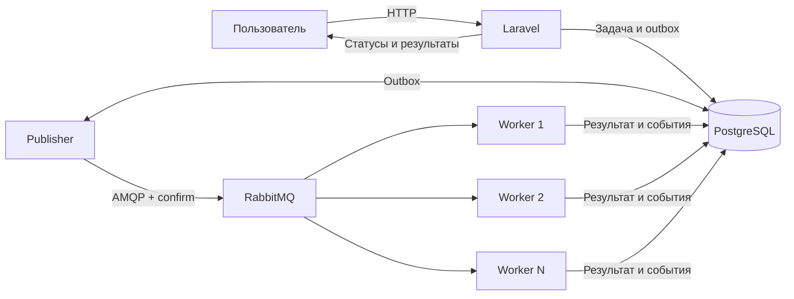

# TaskFlow

**TaskFlow** — веб-платформа для распределённой асинхронной обработки задач. Приложение принимает задания через Laravel, сохраняет их в PostgreSQL, передаёт сообщения через RabbitMQ и выполняет обработку в независимых Worker-процессах. Пользователь может наблюдать состояние задачи, результат и историю выполнения, а администратор — контролировать очередь и обработчики.

## Возможности

- Регистрация, авторизация, профиль и роли `user` / `admin`.
- Создание и отслеживание задач с сохранением параметров, результата и истории событий.
- **Анализ текста:** количество символов, слов, строк и уникальных слов, частотный анализ.
- **Анализ CSV:** структура файла, число записей, пустые значения, числовая статистика.
- **Тестовая нагрузка:** задания с заданной задержкой и измеряемым прогрессом.
- Асинхронная доставка через RabbitMQ и параллельное выполнение несколькими Workers.
- Повторные попытки, transactional outbox, защита от повторной доставки и восстановление прерванных задач.
- Мониторинг RabbitMQ, активности Workers, прогресса и событий обработки.

## Технологии

| Слой | Технологии |
| --- | --- |
| Backend | PHP 8.3+, Laravel 13 |
| Очередь | RabbitMQ 4, Laravel Queue, `vladimir-yuldashev/laravel-queue-rabbitmq` |
| Данные | PostgreSQL 17 |
| Интерфейс | Blade, Tailwind CSS 4, Alpine.js, Vite, Inter |
| Запуск | Docker Compose |
| Тесты | PHPUnit, Node.js test runner |

## Архитектура



HTTP-запрос завершается после сохранения задания. Отдельный publisher публикует сообщение из outbox и получает подтверждение брокера. Свободный Worker обрабатывает задачу, записывает результат и событие в PostgreSQL. Интерфейс получает обновления через HTTP polling. Доставка сообщений имеет семантику **at least once**; повторная доставка учитывается приложением.


## Быстрый запуск

Требования: **Docker Desktop** с Linux-контейнерами и Docker Compose. Устанавливать PHP, Composer и Node.js на Windows для запуска в Docker не требуется.

В **PowerShell** из корневой папки проекта:

```powershell
powershell -ExecutionPolicy Bypass -File .\docker\setup.ps1
docker compose up -d --build --scale worker=3
docker compose ps
```

В **Git Bash** тот же скрипт можно запустить так:

```bash
powershell.exe -ExecutionPolicy Bypass -File docker/setup.ps1
docker compose up -d --build --scale worker=3
docker compose ps
```

Скрипт создаёт локальный `.env` и `APP_KEY`, если они ещё не настроены. Существующий ключ не перезаписывается. Docker автоматически запускает миграции при старте приложения.

После запуска:

- **Веб-приложение:** http://localhost:8000
- **RabbitMQ Management:** http://localhost:15672
- **Проверка готовности:** http://localhost:8000/ready

RabbitMQ Management использует локальную учётную запись `taskflow` и пароль из настройки `TASKFLOW_RABBITMQ_PASSWORD` в `.env`. Настройки локального Docker Compose не предназначены для публичного сервера.

### Пользователи

Обычную учётную запись можно создать на странице регистрации. Для создания администратора выполните:

```bash
docker compose exec app php artisan taskflow:admin admin@example.test
```

Команда запросит пароль скрытым вводом (минимум 12 символов). Для изменения пароля существующего администратора:

```bash
docker compose exec app php artisan taskflow:admin-password admin@example.test
```

Не храните реальные пароли в репозитории и не передавайте их через аргументы командной строки.

## Как пользоваться

1. Войдите в систему и откройте раздел **«Создать задачу»**.
2. Выберите анализ текста, анализ CSV или тестовую нагрузку.
3. Укажите входные данные и отправьте задание.
4. Откройте карточку: там отображаются статус, исполнитель, результат и история событий.
5. Администратор может открыть раздел **«Мониторинг»** и наблюдать обработку в реальном времени.

Чтобы увидеть параллельную обработку, запустите три Workers и в административном интерфейсе выберите **«Запустить нагрузку»**. Система создаст шесть заданий по 10 секунд; в мониторинге будет видно распределение по обработчикам.

Изменить количество Workers:

```bash
docker compose up -d --scale worker=1
docker compose up -d --scale worker=3
```

## Управление контейнерами

```bash
# Состояние контейнеров
docker compose ps

# Журнал приложения, publisher и Workers
docker compose logs --tail=100 app publisher worker

# Состояние очереди
docker compose exec rabbitmq rabbitmqctl list_queues name messages_ready messages_unacknowledged consumers

# Пересобрать приложение после изменений кода
docker compose up -d --build --scale worker=3

# Остановить контейнеры, сохранив данные
docker compose down
```

**Внимание:** не используйте `docker compose down -v` для обычной остановки — этот параметр удаляет тома с данными PostgreSQL, RabbitMQ и файловым хранилищем.

## Тестирование

```bash
# Laravel Unit / Feature
docker compose exec app php vendor/bin/phpunit

# Интеграционные тесты с настоящими RabbitMQ и PostgreSQL
# Запускать при свободной очереди и трёх работающих Workers
docker compose exec app php vendor/bin/phpunit -c phpunit.integration.xml

# Логика визуализации (если Node.js доступен на хосте)
node --test tests/monitor-state.test.js
```

Интеграционные тесты создают собственные задания и проверяют реальные сообщения, параллельное выполнение и повторные попытки. Не запускайте их одновременно с пользовательской нагрузкой. Дополнительные сценарии аварийного завершения приведены в `tests/Integration/`.

## Конфигурация и безопасность

- В Git сохраняются `.env.example` и lock-файлы зависимостей; файл `.env` не должен попадать в репозиторий.
- PostgreSQL и AMQP в локальном Compose не опубликованы наружу; HTTP-порты привязаны к `127.0.0.1`.
- Загруженные CSV хранятся в приватном общем Docker volume, а не в публичной директории.
- Пользователь работает только со своими задачами; мониторинг и повторный запуск окончательных ошибок доступны администратору.
- Локальная конфигурация использует PHP development server. **Для публичного развёртывания** нужны HTTPS, production web server / PHP-FPM, собственные секреты, ограничение сетевого доступа, резервное копирование, аудит безопасности и настройка хранения файлов и событий.
